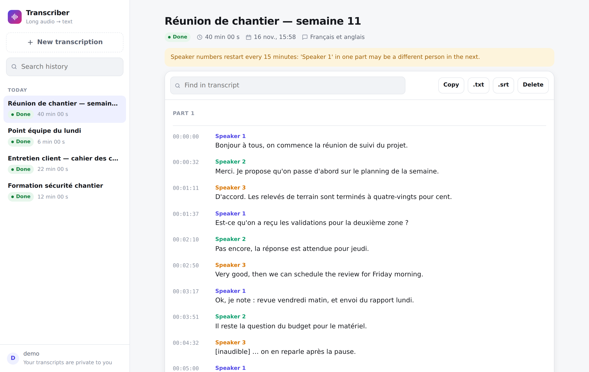
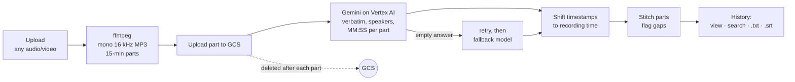
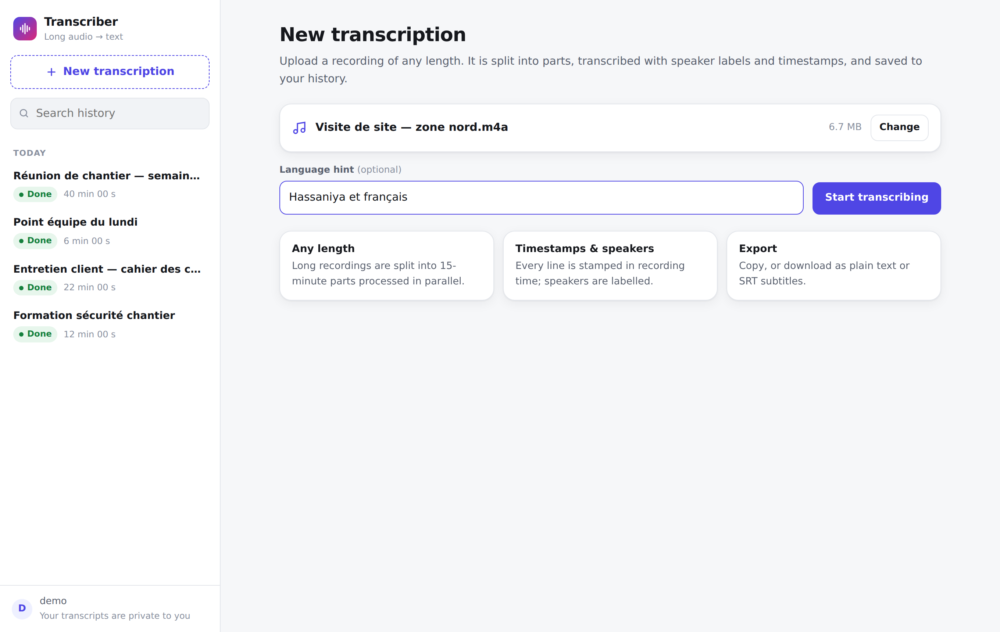
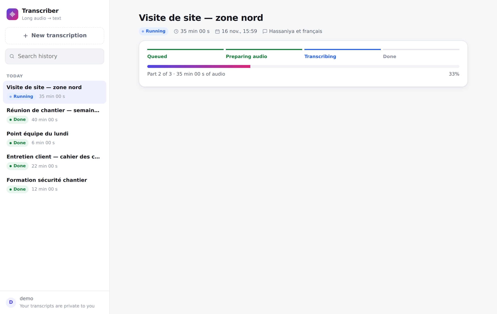
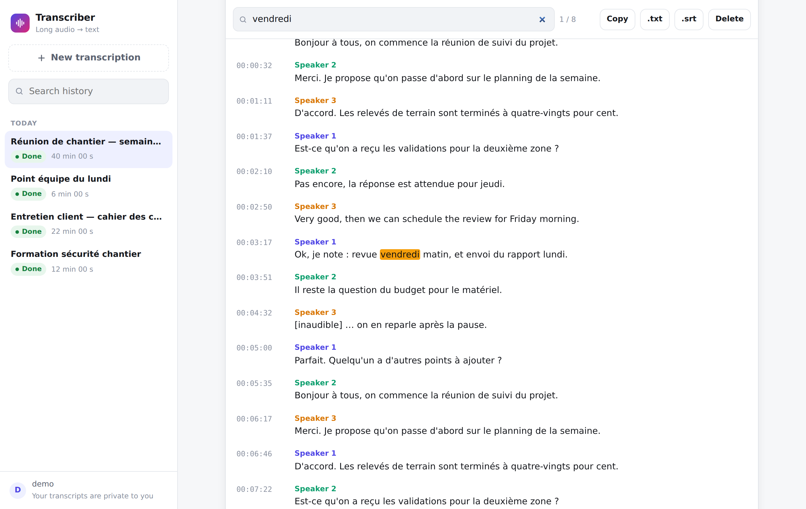
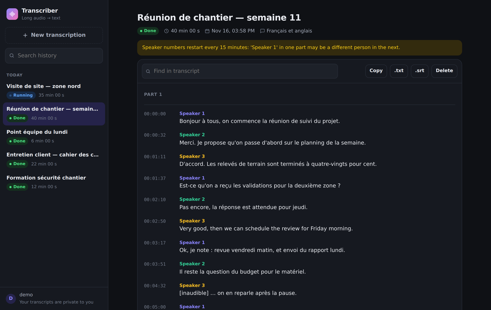
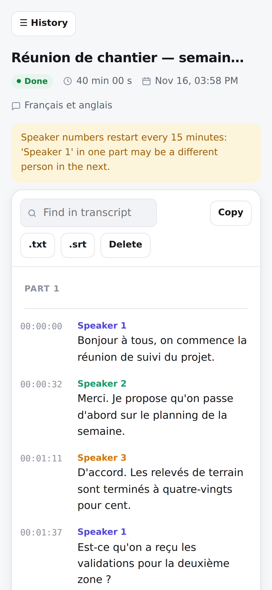
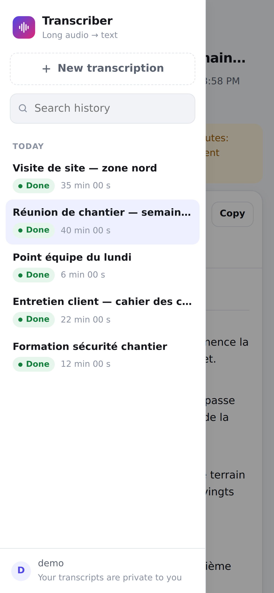

# Long-Audio Transcriber

**A self-hosted web app that turns long recordings (meetings, interviews, field visits) into timestamped, speaker-labelled transcripts with Gemini on Vertex AI. Each user gets a private, searchable history.**

Flask · ffmpeg · Google Cloud Storage · Gemini (Vertex AI) · vanilla JS



> Screenshots come from **demo mode**: synthetic audio, with the model call replaced by a fictional meeting script. Everything else in the pipeline runs for real.

---

## The problem

General-purpose AI chat tools are awkward for **hour-long recordings**. Uploads are capped, a single request hits output limits, timestamps drift, and multilingual speech (e.g. Hassaniya Arabic mixed with French) is often translated or "cleaned up" when it should be transcribed as spoken. Teams also need the transcripts *afterwards*: searchable, exportable as subtitles, and private to whoever uploaded them.

## What it does



- **Any length, any format.** ffmpeg normalises the upload (MP3, M4A, AAC, WAV, OGG/Opus, FLAC, MP4, MKV, WEBM…) and splits it into parts, which are transcribed in parallel.
- **Accurate timestamps.** The model stamps each line relative to its part, and the server shifts every stamp into recording time (`[01:23:45]`).
- **Verbatim, multilingual.** The prompt asks for each utterance in the language and script it was spoken in, never translated. An optional **language hint** can be set per upload.
- **Robust to model hiccups.** Transient API errors get exponential backoff. An empty "200 OK" answer is retried, then sent to a fallback model. A part that still fails is **marked in the transcript** (`[PART NOT TRANSCRIBED: about 15 minutes missing here]`) with a warning, rather than silently dropped. A job interrupted by a restart is marked failed instead of hanging.
- **Per-user history.** Accounts use salted password hashes (`python users.py add <name>`). Each user sees only their own transcripts and can search, rename and delete them. Other users' job IDs return 404.
- **Comfortable reading.** Speakers are colour-coded, in-text search highlights matches (Enter / Shift+Enter to step through), clicking a timestamp copies it, and there's one-click copy plus **.txt** and **.srt** export.
- **Light/dark themes and mobile layout.** Recordings are often made and checked on a phone.

| Upload | Progress | Search in transcript |
|---|---|---|
|  |  |  |

| Dark mode | Mobile | Mobile history |
|---|---|---|
|  |  |  |

## Results

From the production instance, **11 Oct – 6 Nov 2026**. The numbers come from job metadata only; the transcripts themselves are not included.

| Metric | Value |
|---|---|
| Recordings processed | **33** (32 completed, 1 failed) |
| Audio transcribed | **11.4 hours**, from 1 min to **91 min** per file |
| Speed | median **15.8× faster than real time**; the 91-minute file took **2 min 1 s** |
| Parts transcribed | **63 of 67** (94 %); the other 4 came back empty and were marked as gaps in their transcripts |
| Input formats seen | AAC, MP4 (video), M4A, MP3 |

The empty-answer cases led to the retry and fallback-model logic and to the explicit gap markers. A part that fails costs only that part, never the whole transcript.

## Data protection

- Audio is sent to **Vertex AI** (Google Cloud, enterprise terms), not the consumer Gemini app. Under Google Cloud's generative AI data governance terms, customer data is not used to train models without permission.
- The uploaded file is deleted from the server as soon as it has been split. Each part is uploaded to Cloud Storage only for its own request and **deleted right after**. The bucket also has a **1-day auto-delete rule** as a backstop.
- Transcripts stay on your server (`data/jobs/`) until their owner deletes them.
- Binding to anything other than localhost **refuses to start** without accounts or a 12+ character password. Put it behind HTTPS ([`deploy/nginx.conf`](deploy/nginx.conf)), because basic-auth credentials are only as private as the connection.

## Tech stack

- **Backend:** Python, Flask, Waitress, thread pools for jobs and parts, JSON job state written atomically
- **Audio:** ffmpeg (system binary or the bundled `imageio-ffmpeg`)
- **AI:** Gemini via the Google Gen AI SDK on Vertex AI; Google Cloud Storage for part hand-off
- **Auth:** HTTP basic auth against PBKDF2-hashed accounts (Werkzeug), constant-time comparison for the legacy single login
- **Frontend:** one HTML file with vanilla JS and CSS, no build step
- **Tests:** pytest, 16 tests; ffmpeg runs for real, Gemini is simulated

## Project structure

```
long-audio-transcriber/
├── app.py            # settings, auth, audio splitting, transcription jobs, HTTP API
├── users.py          # account management CLI (hashed passwords)
├── demo.py           # DEMO_MODE stand-in for the model call
├── static/index.html # the whole web UI
├── tests/            # end-to-end jobs, timestamp shifting, privacy, SRT, auth
├── deploy/           # systemd unit + HTTPS nginx proxy
└── scripts/screenshots.py
```

### HTTP API

| Method | Path | |
|---|---|---|
| `POST` | `/jobs` | multipart `audio` (+ optional `language`) → `202 {job_id}` |
| `GET` | `/jobs` | the signed-in user's history |
| `GET` | `/jobs/<id>` | status, progress, warnings |
| `PATCH` | `/jobs/<id>` | `{"title": "…"}` |
| `GET` | `/jobs/<id>/transcript.txt` · `.srt` | transcript (`?download=1` for an attachment) |
| `DELETE` | `/jobs/<id>` | remove job and transcript |

## How to run

```bash
git clone https://github.com/MedouLoq/long-audio-transcriber.git
cd long-audio-transcriber
python -m venv .venv && source .venv/bin/activate
pip install -r requirements.txt
```

**Try it without Google Cloud:**

```bash
DEMO_MODE=true python app.py          # http://127.0.0.1:5000
```

**With Vertex AI:**

```bash
cp .env.example .env                  # set GOOGLE_APPLICATION_CREDENTIALS (key kept outside the repo)
python users.py add alice             # one account per person
python app.py
```

The service account needs **Vertex AI User** and **Storage Object User** on the bucket (plus bucket-create rights on first run, or create the bucket yourself). For a server, see [`deploy/`](deploy/): systemd, with nginx terminating HTTPS in front of `127.0.0.1:5000`.

**Tests:**

```bash
pip install -r requirements-dev.txt
pytest
```

## Limitations

- **Speaker numbers restart in each 15-minute part**: "Speaker 1" in one part may be someone else in the next. The app warns about this, and cross-part speaker matching is the main open item.
- The original audio is not kept, so there's no click-to-play from a timestamp.
- Accuracy depends on the model and the recording. There is no word-error-rate benchmark on a labelled set yet.
- Basic auth has no logout or password reset; an account is changed with `users.py`.

## Author

Mohamedou Loughmane ([@MedouLoq](https://github.com/MedouLoq))

## License

[MIT](LICENSE)
